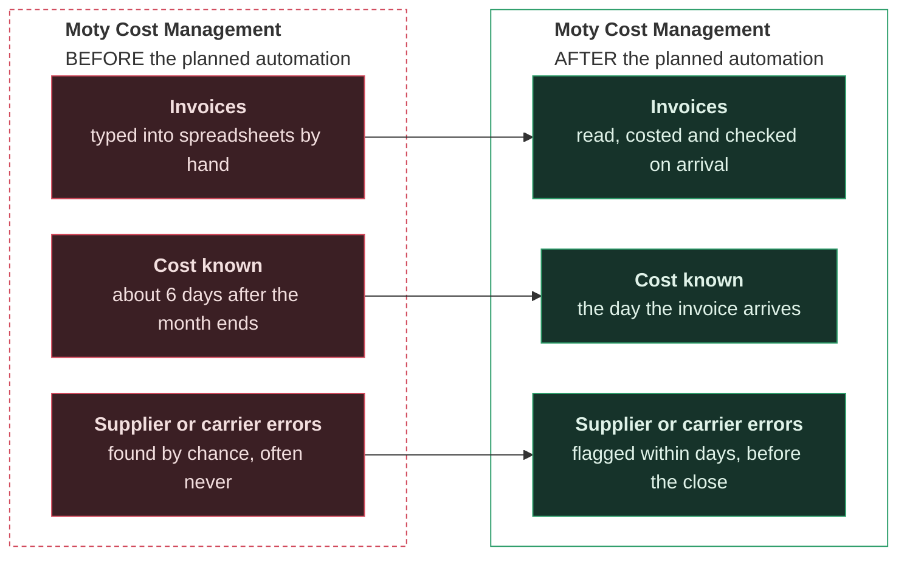
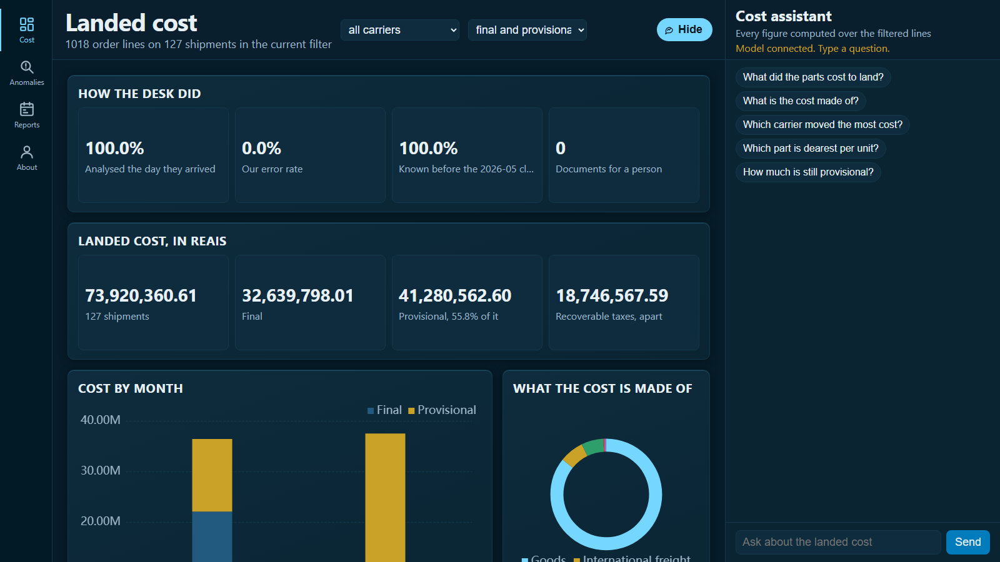
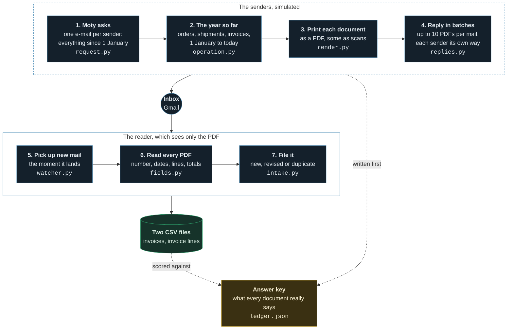
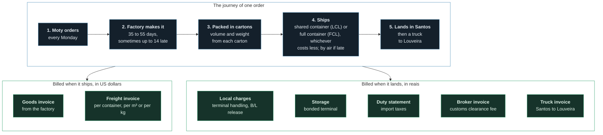

# Invoice pipeline

**First day in Moty's cost department. Nobody kept the invoices.**

Moty imports cosmetics packaging from Asia: bottles, caps, pumps, labels.
Since 1 January, factories, shipping lines, forwarders, a customs broker,
a terminal and a truck company have billed it, *and none of it was filed*.

You work in **Production and Logistics Cost Management**. Your job is to
know **what every part cost to land in Louveira**, by carrier, by
operation and by product, *and to answer management the day they ask*.

The department does not pay invoices and does not choose what is bought.
**It only works out what things cost.**

So the first thing you do is **e-mail every sender: send us every document
issued to Moty since 1 January.** They reply, *each in its own way*, a few
PDFs per mail.

The scenario, before and after:


Why it matters:

- Closing the books takes a typical company **about 6 days** a month
  [[1]](#sources).
- **3 to 6 of every 100** freight invoices have an **error** [[2]](#sources).

The numbers end up in the landed cost dashboard, *where management asks
in plain words and every figure is computed, never guessed:*



Its code: [the dashboard repository](https://github.com/RafaelTavares98/accounts-payable-dashboard-with-ai-chat-and-verified-numbers)

## The shape of it

**From the request to the cost report.** *The answer key is written first
and kept away from the reader.*



**Nothing is dated after today.** Each later run brings only what was
issued since the last one.

## Where an invoice comes from

**Every document comes from an event in the business:** an order, a
shipment, an arrival.



- **A small order ships shared (LCL)**, charged per m³ or per tonne,
  whichever is greater.
- **A big one fills its own container (FCL)**, one price per box, however
  full.
- *Each shipment compares the two, all charges included, and takes the
  cheaper*, as a forwarder quotes both. With 2026 rates the switch falls
  near **46 to 60 m³**, so Moty ships mostly LCL.
- A late order flies 55% of the time if it is small enough, charged per
  kilo or by volume, whichever is greater.

## What the reader is up against

- **A backlog, not a drip.** Months of documents arrive at once, in
  replies of up to 10 PDFs, each sender batching, grouping and wording
  them its own way.
- **Thirteen issuers, each printing its own way.** The same day arrives as
  `2026-04-11`, `04/11/2026` or `11/04/2026`; amounts as `1,234.56` or
  `1.234,56`.
- **Two senders scan.** The Indian label printer sends most of its
  invoices as cheap black-and-white scans, half of them askew; the broker
  scans a signed copy now and then. They are read with OCR. If the lines
  do not add up to the total, *a person gets the row*; the reader never
  guesses.
- **Resends, revisions and credit notes**, as in any real inbox.
- **Ten kinds of error, planted on purpose** for a model to catch later.
  Each has an *honest twin* that looks the same on the page.

And once read, **every part is costed in reais**: freight, local charges,
storage, import duty, broker and truck, each split the way it is charged;
the recoverable taxes kept apart.

## How well it reads

**The reader is scored against the answer key on every run.** The latest
figures, by scan quality: [the reference](docs/reference.md#what-the-reader-scored).

## Set up

You need Python 3.10 or newer.

```bash
git clone https://github.com/RafaelTavares98/invoice-pipeline
cd invoice-pipeline
python -m venv .venv
.venv/Scripts/activate        # .venv/bin/activate on Linux and macOS
pip install -r requirements.txt
```

To read scanned invoices, also install Tesseract
(`winget install UB-Mannheim.TesseractOCR` on Windows,
`sudo apt-get install tesseract-ocr` on Ubuntu). Without it, scans are
filed for a person.

Or with Docker, no Python needed:

```bash
docker build -t invoice-pipeline .
docker run --rm invoice-pipeline
```

## Check that it works

```bash
python run.py smoke
```

**You should see:**

```text
smoke: 1 of 1 read correctly; scans 0 of 0; in ...\Invoices\samples\single
```

One reply came back with one invoice, and the reader filed it and checked
it against its answer, in about a second. Everything it wrote is in
`Invoices/samples/single/`.

## Go further

- **[Tutorial](docs/tutorial.md)**: send the requests, receive the
  backlog, read it, score the reader and cost every part, step by step.
- **[Reference](docs/reference.md)**: every command, file, column, charge
  and rate.

## Sources

1. APQC, "Metric of the Month: Cycle Time for Monthly Close", CFO.com.
   Median 6.4 calendar days; top quarter 4.8.
   <https://www.cfo.com/news/metric-of-the-month-cycle-time-for-monthly-close/659297/>
2. Transportation Insight, "Freight Audit and Payment: Protecting Profit
   in Soft Rates". A typical audit finds errors on 3 to 6% of invoices.
   <https://transportationinsight.com/resources/freight-audit-payment-protect-profit-soft-rates/>

The freight rates and charges behind the model are sourced in
[the reference](docs/reference.md#sources).