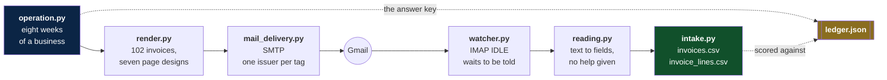
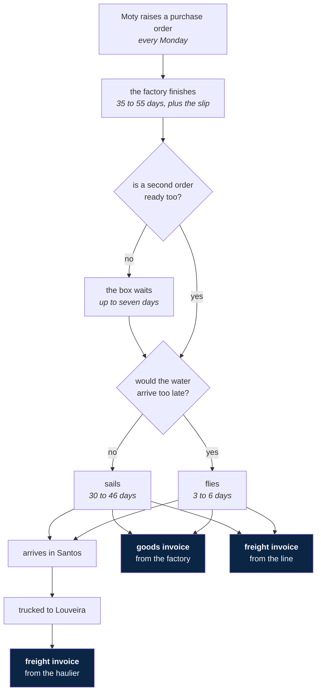

Imagine you just got transferred to the Production and Logistics Cost department in a cosmetics company called Moty.

In your first day you realize that the department inbox has hundreds of unread e-mails, and you should be receiving a hundred more every week, mostly from industries across Asia and carriers all over the world.

Your work is to keep track of all service and transport invoices, by storing them in a sheet and also be able to answer any inquiry from management about the cost related details of any product, producer, or carrier.

---

# Invoice pipeline

**This project invents that inbox, then reads it back.**

One half plays the suppliers. It runs eight weeks of a real importer, one day
at a time, and posts every invoice that falls out of it to a real mailbox. The
other half watches that mailbox and turns the PDFs into two CSV files.

The two halves never meet. The reader is given a PDF and nothing else: no
layout file, no list of suppliers, no hint about which way round the dates
are. That is the only way the score means anything.

## The shape of it



## Where an invoice comes from

Nothing is drawn at random. Every document is the consequence of something
that happened the day before.



A container is paid for whether it is full or not, so a factory holds one
lonely order for a week hoping for company. That one rule is why a freight
invoice often covers two purchase orders, and why the cost has to be split.

The two arguments behind that paragraph:
[a factory waits before shipping](docs/explanation.md#why-a-factory-waits-before-shipping)
and [freight is split between orders](docs/explanation.md#why-freight-is-split-between-orders).

## Who bills Moty

Ten issuers. Moty never issues; it only ever receives. Every one of them bills
in US dollars and prints its own way, because a reader that assumes one shape
falls over on the next.

| Code | Issuer | Sells or moves | Page | Dates | Decimals |
|---|---|---|---|---|---|
| NCL | Ningbo Caplink Industrial | closures, pumps | closed grid | `2026-04-11` | `1,234.56` |
| SBP | Shantou Brightpack | cartons, labels | tinted band | `2026-04-11` | `1,234.56` |
| GZV | Guangzhou Verrelia Glassworks | bottles, jars | boxed form, totals on top | `2026-04-11` | `1,234.56` |
| HCV | Hanil Cosmetic Vessels | pumps, jars | no rules at all | `04/11/2026` | `1,234.56` |
| BDT | Binh Duong Tubeworks | tubes, closures | dashed rows | `11/04/2026` | `1,234.56` |
| ARL | Aravalli Labelworks | labels, cartons | coloured rule | `11/04/2026` | `1.234,56` |
| DHI | DHI Global Forwarding | air freight | wide ledger | `11/04/2026` | `1,234.56` |
| MRK | Marsk Line Agencies | ocean freight | wide ledger | `2026-04-11` | `1,234.56` |
| CSM | COSMO Shipping Lines | ocean freight | closed grid | `2026-04-11` | `1,234.56` |
| KNG | Keuhne & Nager Logistics | road haulage | coloured rule | `11/04/2026` | `1.234,56` |

Two of them write the same day as `04/11/2026` and `11/04/2026`. The reader has
to work out which is which from the page itself.

One page from each is in [the samples folder](samples/README.md). The seven
designs behind the Page column are in
[page styles](docs/reference.md#page-styles), and adding an eleventh issuer is
[a recipe](docs/how-to.md#add-an-eleventh-issuer).

## Five minutes

```bash
pip install -r requirements.txt

python run.py --weeks          # eight weeks of invoices, into out/
python -m pytest               # 253 tests
python watch.py --folder inbox # read a folder, no mail server needed
```

Open [`out/ledger.json`](docs/reference.md#outledgerjson) to see what the
answers are supposed to be, and
[`data/invoices.csv`](docs/reference.md#datainvoicescsv) to see what the
reader found. Walked through one step at a time:
[the tutorial](docs/tutorial.md).

Sending real mail needs two environment variables and one password in the
keychain.
[The how-to guide](docs/how-to.md#send-the-invoices-as-real-e-mail) covers it.

## One run

| | |
|---|---|
| Purchase orders raised | 79 |
| Shipments that left a port | 44 |
| Invoices in the window | 102 |
| Goods invoices | 44 |
| Freight invoices | 56 |
| Credit notes | 2 |
| Resends: same number, same bytes | 9 |
| Revisions, `-R1` | 4 |
| Invoices quoting the wrong order | 2 |
| Chains with a landed cost | 31 |
| Freight as a share of goods | about 8% |

The defects are deliberate. A clean corpus teaches a reader nothing. The
reasoning is in
[why defects are injected on purpose](docs/explanation.md#why-defects-are-injected-on-purpose),
and the rates are in [defect rates](docs/reference.md#defect-rates).

## What the reader scored

102 invoices arrive. Nine are resends of a document already read, so 93
distinct documents reach the CSV. Measured against `ledger.json`:

| Field | Correct |
|---|---|
| Grand total | 93 / 93 |
| Issue date | 93 / 93 |
| Line count | 93 / 93 |
| Flagged as unreadable | 0 |

It also works out what each document is: 87 new, 3 revisions, and 3 earlier
invoices marked `superseded` because a revision replaced them.

The fourth revision corrects an invoice issued before the window opened. There
is nothing on file to supersede, so it is filed as new. That is right: a
reader cannot replace a document it never received.

It gets there without seeing `issuers.py`. It counts how numbers end to find
the decimal mark, reads every date on the page to settle the order, and finds
the table by its heading rather than by guessing which lines hold numbers.

Each of those three is argued separately:
[the reader is blind](docs/explanation.md#why-the-reader-is-blind),
[the table is found by its heading](docs/explanation.md#why-the-table-is-found-by-its-heading),
[the quantity column is counted from the right](docs/explanation.md#why-the-quantity-column-is-counted-from-the-right).

## The files

```
run.py                  make the invoices
watch.py                read the mailbox

src/
  the business
    buyer.py            Moty, the one being billed
    issuers.py          the ten who bill
    catalogue.py        sixteen packaging components
    lanes.py            which port, which carrier, how many days
    orders.py           purchase order, shipment, dispatch
    invoice.py          the invoice and its arithmetic

  making it happen
    operation.py        the eight week clock
    pricing.py          where the numbers come from
    defects.py          duplicates, revisions, credit notes
    invoice_builder.py  one invoice, outside the simulation
    ledger.py           the answer key

  drawing the page
    render.py           invoice to PDF
    layouts.py          what each issuer's page is made of
    page_drawing.py     the parts every design shares
    page_styles.py      the seven designs
    formatting.py       how each issuer writes a number and a date

  the mailbox
    mail_delivery.py    sending, with the password in the keychain
    mail_sources.py     a folder of .eml, or a real IMAP account
    watcher.py          IMAP IDLE, and the hourly safety net

  reading it back
    reading.py          text to fields, with no help
    intake.py           the two CSV files, and never twice

tests/                  253 tests
samples/                one invoice per issuer, and the answers
```

[The samples folder](samples/README.md) holds a page from each of the ten, so
the designs can be looked at before anything is installed.

## The four documents

Read them in this order. The last two are for looking things up, not for
reading straight through.

| # | Document | Read it when |
|---|---|---|
| 1 | [Tutorial](docs/tutorial.md) | you have never run this and want one invoice, end to end |
| 2 | [Explanation](docs/explanation.md) | you want to know why it is built this way |
| 3 | [Reference](docs/reference.md) | you need a command, a column, or a module |
| 4 | [How-to guide](docs/how-to.md) | you know it already and need a recipe |

Every page carries the other three at the top, and each section links across
to the matching one: a figure in the reference, the argument behind it in the
explanation, the way to change it in the how-to guide.

## What this is not

It does not pay anybody, file anything, or talk to an accounting system. It
makes invoices that look real and reads them back, so that a reader can be
measured against an answer key instead of against an opinion.
